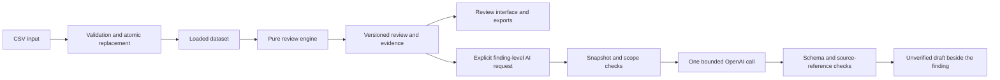

# Deterministic review architecture

## Current flow

## Boundaries

- **Data ingestion:** app/data_loader.py validates required columns, grouping fields, monthly periods, and finite amounts. app/main.py enforces a 5 MB limit per uploaded file while copying it. Only a fully validated store replaces the previous store. Budget-only uploads create an empty ledger. The file-size guard operates after multipart parsing; a public deployment also needs an ingress request-body limit.
- **Review engine:** app/review.py has no model calls or network dependency. It groups budget rows by month and case-insensitive department/account, sums using Decimal representations of loaded amounts, applies materiality, and compares the immediate prior calendar month. A zero variance is never material, including at a zero threshold.
- **Evidence:** app/evidence.py provides full-slice totals, displayed-subset totals, transaction source IDs, and reconciliation. Duplicate candidates remain in totals. Orphan transactions are reported by source row. Multiple budget rows are aggregated with a flag rather than silently interpreted as duplicates.
- **Snapshot contract:** the dataset digest covers canonical loaded rows from both input tables. The review digest also includes engine version and policy. Stable finding IDs bind a scope to its dataset. They identify data, not authenticity or authorization.
- **Report packet:** includes complete loaded inputs, exact numeric strings, policy, findings, evidence, and limitations. Source data includes out-of-scope periods for comparisons. Export is lossless relative to the loaded representation, not necessarily the original CSV bytes.
- **Optional assistance:** app/assist.py receives only the selected finding, including relevant budget rows and up to 25 transaction rows. It has no tools, arbitrary query interface, or access to other findings. Drafts contain observations, hypotheses, and questions. Local checks reject invented references and malformed output. Reference existence does not establish that a claim is supported. No automatic causal verification is claimed.
- **Browser:** text from uploads and model output is HTML-escaped; no Markdown HTML is executed. A self-only content security policy blocks external scripts. JSON exports preserve notes and drafts separately. CSV text cells escape spreadsheet formula prefixes. Currency formatting is display only; exact strings remain in the packet.

## API

| Endpoint | Purpose |
| --- | --- |
| GET /api/review?period=YYYY-MM&min_abs_variance=1000 | Complete deterministic report, no key required |
| POST /api/upload | Atomically replace the local dataset after validation |
| POST /api/reset | Restore fictional sample |
| GET /api/dataset | Dataset metadata |
| GET /api/health | Key availability boolean and configured model, never the key |
| POST /api/review/investigate | Rebuild and match review_id, resolve finding_id, then request a draft |
| GET /api/investigate | Legacy SSE research baseline; disabled unless explicitly configured |

AI responses echo review_id and finding_id. Changed data or materiality yields 409 before a model call. Unknown findings yield 404, absent credentials 503, occupied AI slot 429, and unusable provider output 502. Failures leave the deterministic report intact. The new AI adapter uses a 60-second SDK timeout, zero retries, and a 2,500-token output cap.

## Known boundaries and next production layer

The repository deliberately remains single-user and in-memory. Uploads replace a process-global store. Snapshot IDs do not provide access control. Notes exist only in browser memory; reviewed checkboxes are personal markers, not audit signatures. The concurrency semaphore is process-local and is not a spending cap. Legacy-agent opt-in bypasses the new finding-level restriction and belongs only in private evaluation.

Before shared hosting, replace the global store with authenticated tenant-owned dataset storage and immutable report records. Require authorization on every record read/write, add job/usage limits across workers, record review events with identities, establish data deletion and provider handling policies, and enforce ingress size/rate controls. Deploy only after isolation and authorization tests pass.

## Evaluation

The deterministic baseline is independently testable without a provider. Compare it against the optional AI workflow using task completion time, analyst corrections, unsupported claims, citation validity, and evidence coverage. Do not equate simulated SDK tests with model accuracy or successful reconciliation with causal truth.
